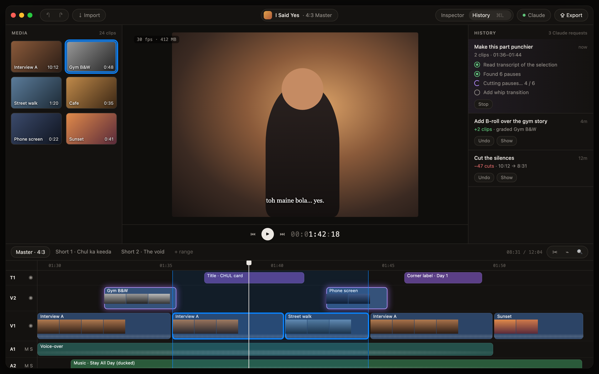
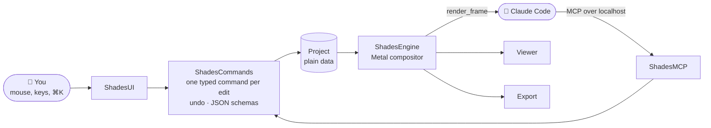

<h1 align="center">Shades</h1>

<p align="center"><b>The video editor Claude can drive.</b><br>
An open-source, Metal-fast editor for Mac. Edit by hand, or let Claude Code cut, grade, animate,<br>caption and export over MCP, live on your timeline.</p>

<p align="center">
  <a href="https://github.com/sazuyakun/shades/actions/workflows/ci.yml"></a>
  
  
  
  
  <a href="LICENSE"></a>
</p>

<p align="center">
  <a href="#why-shades">Why Shades</a> ·
  <a href="#whats-inside">What's inside</a> ·
  <a href="#connect-claude">Connect Claude</a> ·
  <a href="#build-from-source">Build</a> ·
  <a href="#docs">Docs</a>
</p>

<p align="center"></p>

## Why Shades

- 🤖 **Claude can do anything you can.** Every edit is a command, and every command is an MCP tool. Claude cuts, grades, animates, captions and exports in the same editor you use, and renders frames to check its own work.
- 👀 **You see every change.** Claude's edits appear live and glow on the timeline. The History pane (⌘L) lists each request with **Undo** and **Show**, and a whole request is one undo step.
- 🔑 **Bring your own Claude.** There's no AI inside the app: no chat box, no API keys, no logins. Connect Claude Code on your own plan.
- 🎨 **Taste is a plugin.** Shades ships neutral primitives. Looks, title templates, stickers, sounds and fonts come from plugin folders that hot-reload.
- ⚡ **Smooth on a base M1 with 8 GB.** Built on Metal and AVFoundation. If it plays here, it plays everywhere.
- 🔒 **Local-first.** Projects live in `~/Shades` as readable JSON, footage stays where it is, and transcription, cut-outs and stem separation all run on your Mac.

## What's inside

| | |
|---|---|
| ✂️ **Timeline** | Multi-track video, text, caption and audio tracks. Blade, trim, ripple, snapping, markers, speed ramps, freeze frames, keyframes with easing and springs. Autosave, snapshots and crash recovery |
| 🧍 **Layers & cut-outs** | Depth slots put text and graphics *behind* the subject. Apple Vision mattes, motion tracking and follow, auto-reframe from 16:9 to 4:3 |
| 🔤 **Type & motion** | Core Text rendered into Metal, kinetic words from the transcript, bent text, 3D layers and a camera, die-cut stickers with motion presets, hand-drawn lines that boil |
| 🎞️ **Color & effects** | Primaries, curves, LUTs, qualifiers, windows, grain, halation, vignette, blend modes, keys, scopes, transitions (dissolve, whip, slices, tiles, iris portal) and Metal shader effects Claude can write |
| 🗣️ **Speech & Polish** | On-device WhisperKit transcripts with word timings (Hinglish included), captions, SRT, and Polish: propose → review → apply for silences, fillers, retakes, beat-snapped cuts and punch-ins |
| 🔊 **Audio** | Waveforms, gain and fades, volume keyframes, ducking under speech, loudness to a target (BS.1770), noise reduction, voice/music stem separation, sound effects |
| 📤 **Export** | YouTube 16:9 and Reels/Shorts 9:16 canvases, marked shorts exported in a batch, frames, GIFs and SRT, on a background queue with a chime when done |

## How it works



You and Claude go through the same door. A click, a shortcut, the ⌘K palette and an MCP tool all run the same command, so undo, autosave and the History pane cover everything. Preview, export and the frames Claude looks at are drawn by the same Metal compositor, so what you see is what you export.

## Connect Claude

Open Shades. Its MCP server listens on `127.0.0.1:4747`. Add it to Claude Code once:

```bash
claude mcp add --transport http shades http://127.0.0.1:4747/mcp
```

Then ask, for example:

> *"Cut the silences and fillers between 1:30 and 2:00, then show me what you'd change."*
>
> *"Put the title BEHIND HER as a word-by-word pop, and grade the gym shots black and white."*
>
> *"Duck the music under my voice, and export a YouTube cut plus the marked shorts."*

Claude can call `get_guide` to learn the editor, and `render_frame`, `render_preview` (frames over time with the sound) and `get_scopes` to see the result.

## Build from source

You need an Apple Silicon Mac on macOS 15 or later, Xcode 26 and [XcodeGen](https://github.com/yonaskolb/XcodeGen).

```bash
xcodegen generate --spec apps/mac/project.yml --project apps/mac
```

```bash
xcodebuild -project apps/mac/Shades.xcodeproj -scheme Shades -derivedDataPath apps/mac/.build build
```

```bash
open apps/mac/.build/Build/Products/Debug/Shades.app
```

The app is a thin shell. Everything else is the `ShadesKit` Swift package, one module per system, with its tests:

```bash
swift test --package-path packages/ShadesKit
```

## Performance

Measured on a base M1 with 8 GB of RAM, from real iPhone 16 footage:

| | |
|---|---|
| ▶️ Three 4K HEVC layers + grade + grain + a behind-subject title | **24–25 fps**, 133 MB |
| 📂 Reopen a 31-minute, 60-clip project | **0.4 s** |
| 🚀 Launch to an open project | **0.7 s** |
| 💤 Idle CPU | **0.2–0.4%** |
| 📤 28.5 s timeline to 4K HEVC | **15 s** (faster than real time) |

CI gates every push on formatting, strict lint, golden-frame render tests and performance budgets.

## Status

All nine build milestones are done, from the Metal foundation to export and performance ([plan](docs/PLAN.md)). There's no downloadable release yet: the website, auto-updates and a real app icon come first ([launch checklist](docs/LAUNCH.md)). Until then, build from source.

## Docs

| Want to… | Read |
|---|---|
| Understand how the whole product works | [SYSTEM.md](docs/SYSTEM.md) |
| See the scope, milestones and known issues | [PLAN.md](docs/PLAN.md) |
| See the look and the keymap | [DESIGN.md](docs/DESIGN.md) · [UX.md](docs/UX.md) |
| Find your way around the code | [ARCHITECTURE.md](docs/ARCHITECTURE.md) |
| Work on the repo with an agent | [CLAUDE.md](CLAUDE.md) |

## License

[MIT](LICENSE). Models are downloaded on first use, never bundled, and are MIT or Apache-2.0.
