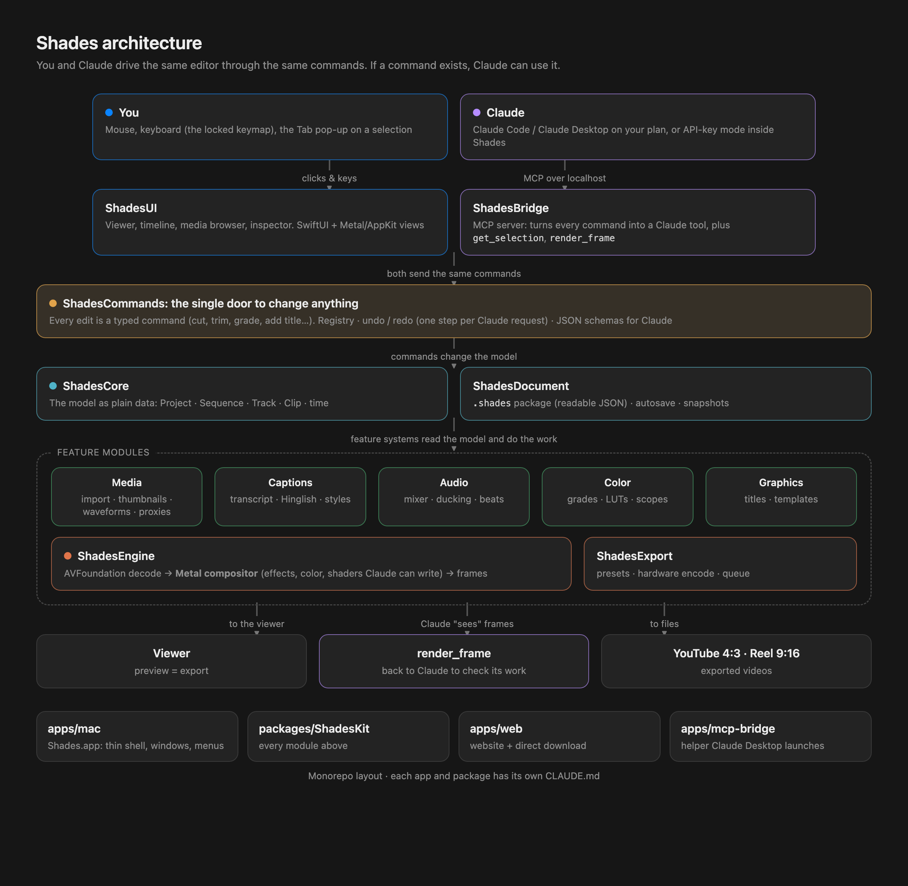
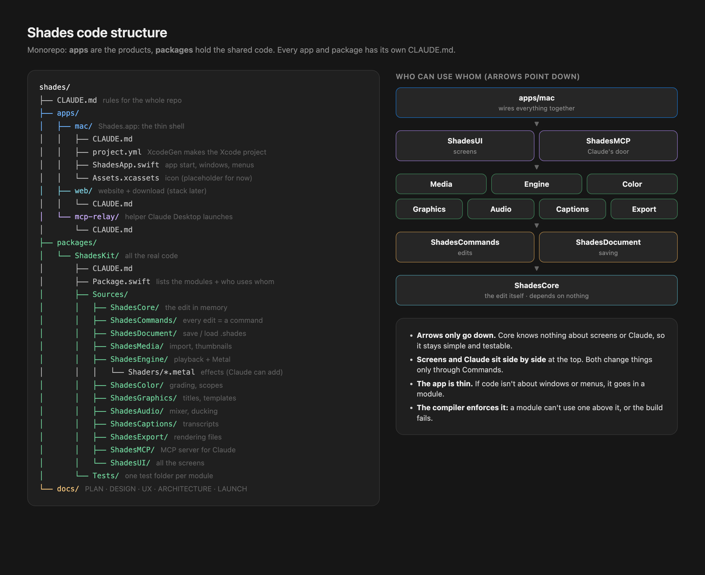

# Shades: code structure



## Layout


```
shades/
├── apps/
│   ├── mac/                  Shades.app: a thin app target (entry point, windows, menus, assets)
│   │   └── project.yml       XcodeGen spec; the .xcodeproj is generated, not committed
│   ├── web/                  the Shades website + download page (stack decided later)
│   └── mcp/                  relay Claude Code & Desktop launch; pipes to Shades.app
├── packages/
│   └── ShadesKit/            all real Mac code, as Swift Package modules
│       ├── Package.swift
│       ├── Sources/
│       │   ├── ShadesCore/       model types: Project, Sequence, Track, Clip, time, IDs
│       │   ├── ShadesCommands/   command protocol, registry, undo, JSON schemas
│       │   ├── ShadesDocument/   .shades package, autosave, snapshots
│       │   ├── ShadesMedia/      import, analysis, thumbnails, waveforms, proxies
│       │   ├── ShadesEngine/     AVComposition builder, Metal compositor, playback, shaders
│       │   ├── ShadesColor/      color management, grade nodes, LUTs, scopes
│       │   ├── ShadesGraphics/   titles, templates, keyframes
│       │   ├── ShadesAudio/      mixer, ducking, loudness, beats
│       │   ├── ShadesCaptions/   transcription, caption styles
│       │   ├── ShadesExport/     presets, encode queue
│       │   ├── ShadesMCP/     MCP server: commands become Claude tools
│       │   └── ShadesUI/         SwiftUI views (AppKit where SwiftUI is too slow)
│       └── Tests/
└── docs/
```

## Rules
1. **Dependencies point one way:** Core → Commands / Document → feature modules (Media, Engine, Color, Graphics, Audio, Captions, Export) → MCP and UI → the app. Core imports only Foundation, and nothing imports UI except the app.
2. **Every edit is a command.** A command is a small `Codable` struct with a name, a description and parameters. The registry exposes each command to menus and shortcuts, undo, and Claude (as an MCP tool). A new feature means a new command, and Claude gets it automatically.
3. **The model is plain data.** The engine reads the model and builds what plays. The UI never touches AVFoundation directly.
4. **Shaders ship as `.metal` source and compile at runtime**, so Claude can write new effects while the app runs.

## Tooling
- **Swift 6, strict concurrency.** Actors for caches and analysis; render paths stay off the main thread.
- **SwiftUI with `@Observable`.** AppKit/Metal views for the timeline canvas and the viewer.
- **XcodeGen** generates `apps/mac/Shades.xcodeproj` from `project.yml`.
- **Swift Testing** for logic, plus rendered-frame snapshot tests so preview and export stay identical.
- Builds use `DEVELOPER_DIR=/Applications/Xcode.app/Contents/Developer`.
- **Minimum macOS 15**, Apple Silicon only.
