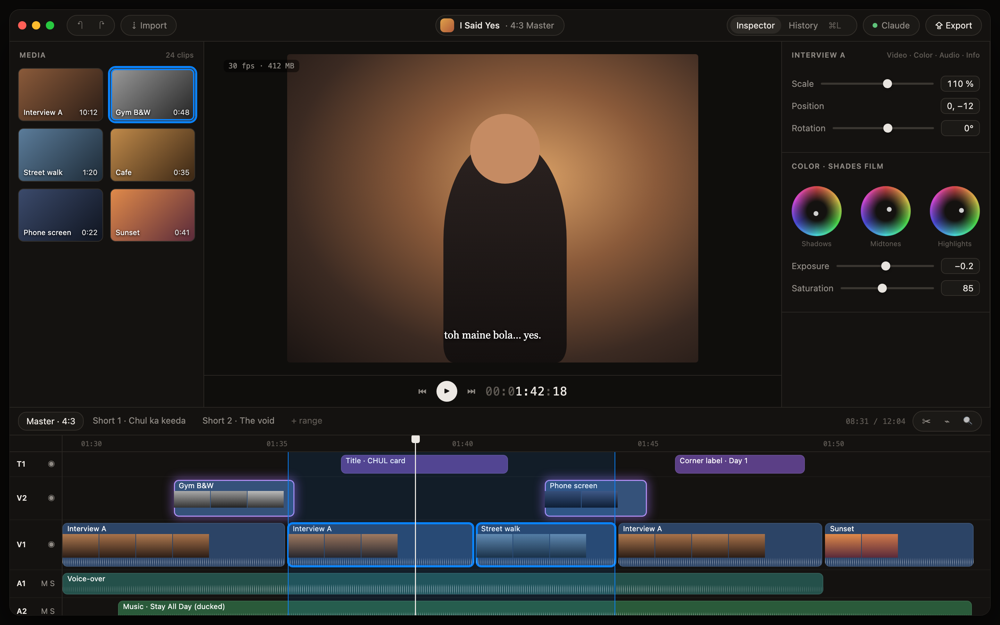

# Shades: design (main window)

Locked target look, **v2**: a Final Cut layout with a Cursor/Glaze skin. Source: [design/mockup.html](design/mockup.html) (open `mockup.html?claude` for the History pane state). There is **no AI inside the app**: Claude works over MCP, and the UI only shows what it did.

**Editing:**

**History pane open (⌘L):**

## Decisions
| Topic | Decision |
|---|---|
| Overall feel | Final Cut's calm, efficient layout, with the minimal modern skin of Cursor and Raycast's Glaze |
| Layout | FCP classic: media browser left, viewer center, inspector right, timeline across the bottom |
| Background | One **warm near-black** (`#141210`), shared by every pane. Panes are separated by **1px hairlines** (`#2a2723`), not boxes or grey panels. No translucency. The video frame itself is never tinted |
| Title bar | A centered **title pill** ("I Said Yes · 4:3 Master"). Buttons are grouped in **capsules**: undo/redo and Import on the left; Inspector ⇄ History and Export on the right, plus the Claude connection dot |
| Typography | Small grey uppercase section labels (`MEDIA`, `COLOR · SHADES FILM`), white titles, secondary text in warm grey. Monospace only for timecode and the HUD |
| Controls | Glaze-style capsules: pill buttons and tabs, rounded value fields, a round white play button, about 12px corner radius on panels and sheets |
| Pages | One screen. Inspector tabs: Video · Color · Audio · Info. Scopes open beside the viewer when needed |
| Timeline | FCP-style rounded clips with filmstrips and waveforms, slim track headers (T1, V2, V1, A1, A2), short ranges marked as capsules above it, and a playhead with a rounded handle |
| Accent | The user's macOS system accent color for selection; white for the playhead |
| Density | FCP density: small system font, compact rows |
| Media browser | Thumbnail grid with rounded corners and hover-scrub |
| History pane (⌘L) | Toggleable; replaces the inspector. A **Cursor-style list** of every change Claude made over MCP: each request with its time, its steps as quiet lines (✓ done, ◌ in progress), the result in green or red ("+2 clips", "−47 cuts"), and **Undo** / **Show** buttons. Read-only: no prompt or chat |
| AI changes | Clips Claude changed glow soft purple, then fade; a toast with Undo. Purple is reserved for AI |

## Inspiration
- Cursor 3 (agent task list, hairline layout, warm near-black, restrained accents): https://cursor.com
- Raycast Glaze (title pill, capsule controls, in-place prompt bar, agent steps as quiet lines): https://raycast.com/blog/introducing-glaze · https://raycast.com/blog/meet-glaze · https://glaze.app
- Final Cut Pro (layout, timeline): https://www.apple.com/final-cut-pro/
- v1 (classic pro dark) is in git history if it's ever needed again.
