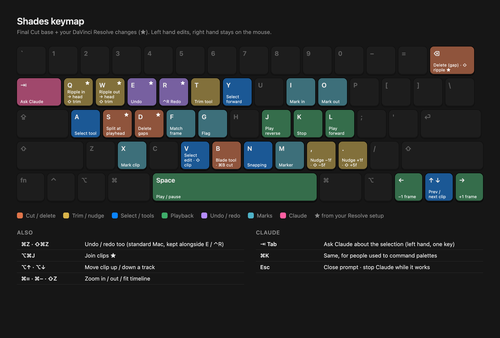

# Shades: user experience

How Shades behaves. The look is in [DESIGN.md](DESIGN.md).

**Principle:** one hand on the mouse, the other on the keyboard for edits. Claude works over MCP from Claude Code; inside the app you only ever see what it did.

## Getting in
| Moment | Behaviour |
|---|---|
| Opening Shades | A small native welcome window: **New Project**, recent projects with thumbnails, and "drop footage here" |
| New project | Name it and pick a size: **2880×2160** (default) or **1440×1080**, both 4:3, plus a frame rate (24, 30 or 60; default **24**) |
| Format | Every timeline is a 4:3 picture. Clips of any shape are fitted inside it upright (16:9 iPhone footage is auto-reframed to 4:3). The 9:16 and 16:9 versions are only canvases added at export |
| Importing | Media stays where it is on disk; Shades links to it and copies nothing. "Collect media" copies into the project later if wanted |
| Background work | Thumbnails, waveforms, transcripts and proxies run quietly. A progress ring sits in the toolbar; click it for details. Nothing blocks editing |
| Shorts | Marked as named ranges on the master timeline ("Short 1 · Chul ka keeda") and exported in a batch on the 9:16 canvas. They show as capsules above the ruler and as tabs in the timeline's title bar: click one to pick it (its stretch is tinted across the tracks), drag its ends to adjust it, right-click to rename or remove it. **+ range** (⌥M) marks the selected clips' stretch. The short actions change the picked short, or else the one under the playhead |

## Editing by hand
- **Choosing a range:** hover-scrub a thumbnail in the media browser and press **I** / **O** to mark just the part you want. There's no separate source viewer.
- **Dragging onto the timeline inserts**: later clips move right. Hold **⌘** while dropping to overwrite instead.
- **One-key edits** put the marked part on the timeline without dragging: **R** append to end, **Z** insert at playhead, **⌥Z** overwrite at playhead, **C** place on top (the track above, for B-roll).
- **Linking:** a clip's own audio moves with it (**⇧⌘L** to unlink). Clips on other tracks stay where they are.
- **Speed:** the inspector's Speed slider (Video tab, or Audio for sound clips) slows a clip down or speeds it up; it keeps its first and last frames, so it grows or shrinks and later clips on its track follow. The slider's diamond adds speed keyframes for a ramp. **⌥F** holds the frame at the playhead for 2 s; the timeline marks retimed clips "2×", "Ramp" or "Freeze".
- **Mixer (⌥⌘A):** a strip for every track that makes sound (video tracks carry their clips' own): mute, solo, a stereo meter, level and pan, then the master's meter and level and **Normalize** for a platform (YouTube, Instagram & Reels, TikTok −14 LUFS, podcast −16, broadcast −23), which also sets a limiter holding true peaks under −1 dBTP. Track headers mute any track with sound. Pan moves stereo sound; mono sound stays centred.
- **Deleting leaves a gap** (lift). **⇧⌫** is ripple delete, and **D** closes all gaps.
- **Keyboard:** Final Cut shortcuts as the base, with the creator's DaVinci Resolve customizations on top. Editing lives on the left hand.

| Key | Action |
|---|---|
| A · B · T · P | Select tool · Blade tool · Trim tool · Draw tool (drag in the viewer to draw lines over the picture) |
| ⌥T | Track tool: drag a box in the viewer around something; it's followed to the clip's end in the background, and layers can follow it (Video tab › Follow) |
| S · ⌘B | Split at playhead |
| Q · W | Ripple trim start / end to playhead |
| ⇧Q · ⇧W | Trim start / end to playhead (no ripple) |
| R · Z · ⌥Z · C | Append · Insert · Overwrite · Place on top |
| E · ⌘Z | Undo |
| ⌃R · ⇧⌘Z | Redo |
| D | Delete gaps |
| ⌫ · ⇧⌫ | Delete (leave gap) · Ripple delete |
| V · ⇧V · Y | Select nearest edit · Select clip at playhead · Select forward |
| I · O · X · M · G · F | Mark in · Mark out · Mark clip · Marker · Flag · Match frame |
| ⌃M | Remove the marker at the playhead (or right-click a marker on the ruler) |
| ⌃T · ⇧C · ⌥A | Add text at the playhead · Add the chosen picture as a sticker · Add an adjustment clip (over the selection, or 5 s) |
| ⌘T | Add a dissolve into the selected clips (pick another kind and its length in the Video tab) |
| ⌥U · ⌥⇧U | Cut out the person · any object in the selected clips |
| ⌥B · ⌥D · ⌥L | Find speech and beats · Duck the music under speech · Normalize loudness to −14 LUFS |
| Space · J K L | Play / pause · Reverse / stop / forward |
| ← → · ↑ ↓ | Frame step · Previous / next clip |
| , . · ⇧, ⇧. | Nudge 1 frame · 5 frames |
| N | Snapping on / off (on by default) |
| ⌥⌘J | Join clips |
| ⌥⌘W | Split text into words: one layer per word, each where it sat in the line |
| ⌥F · ⇧N | Freeze the frame at the playhead for 2 s · Back to normal speed |
| ⌥↑ · ⌥↓ | Move clip up / down a track |
| ⌘= · ⌘− · ⇧Z | Zoom in / out / fit |
| ⇧⌘L | Link / unlink audio and video |
| ⌥R · ⇧⌥R | Reframe the selected clips: pan with the subject · locked on one framing |
| ⌥M · ⌥N · ⇧⌥M | Mark the selected clips' stretch as a short · Rename the short · Remove it |
| ⌥I · ⌥O | Move the short's start / end to the playhead |
| ⌘S · ⌘E | Named checkpoint · Export |
| ⌘K | Command palette: every action by name |
| ⌘L | Show or hide the History pane |
| ⌥⌘S | Show or hide the scopes (waveform, vectorscope, histogram) beside the viewer |
| ⌥⌘A | Show or hide the mixer |
| ⌥H | Preview quality: Auto, Full or Half |
| Esc | Close a sheet or palette |

All shortcuts are remappable.

**Where the rest lives:** the timeline bar has **Templates**, **Motion** (pop, slide in, float, orbit, scatter, stack on the selected clips) and **Sounds** (plugin sound effects at the playhead). With no clip selected, the inspector's Video tab moves the **camera**. Each keyframe diamond has an **easing** menu beside it once a keyframe sits at the playhead. The Color tab has **curves** (all, red, green, blue), a **qualifier** (only some colours), a **window** (only inside a shape, which can be keyframed and follow the subject or a tracked path) and the **key**'s colour, tolerance and softness.

## Working with Claude
There's no AI inside Shades: Claude Code edits over MCP ([SYSTEM.md](SYSTEM.md)), and the app shows what it did.
1. **Edits appear live** on the timeline while Claude works. Changed clips glow soft purple, then fade.
2. **A toast** summarises each request ("Claude · removed 47 pauses") with **Undo**. The whole request is one undo step.
3. **The History pane (⌘L)** swaps the inspector for a read-only list of every change Claude made: the request, its result ("+2 clips", "−47 cuts"), and **Undo** / **Show** per request. It's an edit log, not a chat.

**Connection status:** a pill in the toolbar shows **● Claude ready** (green) or **● Claude offline** (red). Clicking it explains why and what to do, e.g. "port 4747 is already in use, usually by another copy of Shades. Quit it, then reopen Shades." In the v2 restyle it becomes the dot on the ✦ Claude capsule.

**First-time setup:** connect once from a terminal with `claude mcp add --transport http shades http://127.0.0.1:4747/mcp`. Settings › Claude shows the command with a Copy button.

## Playback
Auto quality. When footage is too heavy to play in real time, Shades quietly lowers preview resolution or switches to proxies to stay smooth. A small "Proxy" badge in the viewer shows when proxies play. The quality menu in the viewer's corner (**⌥H** steps through it) picks **Auto** (full size, dropping to half while playing once frames can't keep up; it reads "Auto · Half" then, and paused frames are full size again), **Full** or **Half** (half the width and height, a quarter of the pixels). Export and Claude's frames are always full quality.

## Saving & safety
| Moment | Behaviour |
|---|---|
| Saving | Always autosaved, so there's no Save button. **⌘S** makes a named checkpoint |
| Versions | Automatic snapshot every 10 minutes and **before every Claude request**. Browse them in File › Revert To, with thumbnails |
| Crash | On relaunch the project reopens silently, exactly where you were (playhead, zoom, selection), with a small "Recovered" note |

## Export
- **⌘E** opens a sheet: **YouTube** (4:3 picture on a 16:9 black canvas), **Reels/Shorts** (4:3 picture on a 9:16 black canvas, one file per short range), **Frame**, **GIF** or **SRT**, plus file name and location.
- Press Export and keep editing; progress shows in the toolbar ring. Several exports can be queued.
- **When it's done** (or when Claude finishes while you're in another app), Shades plays a soft chime and shows a native Mac notification. Clicking it reveals the file or jumps to the edit.
